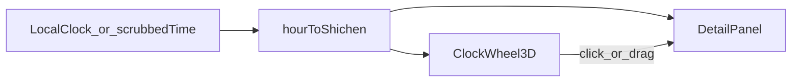

# 000 — Architecture snapshot

- **Repo:** `shichen`
- **Status:** current
- **Date:** 2026-09-10
- **Related:** [001-3d-shichen-explainer.md](sdd/001-3d-shichen-explainer.md)

## What it is

A single-page Chinese explainer for the twelve *shichen* (时辰). A 3D clock wheel teaches the 24-hour mapping; an HTML side panel holds longer cultural notes (nested time units, night watches, wuxing, TCM-as-culture).

## Stack

| Layer | Choice |
| --- | --- |
| App | Vite, React 19, TypeScript |
| 3D | `@react-three/fiber`, `@react-three/drei`, Three.js |
| UI | Plain CSS overlay (not in the canvas) |
| Data | Static `src/data/shichen.ts` (rewritten copy, not scraped) |
| Tests | Vitest: `src/lib/time.test.ts`, `src/App.test.tsx` (ClockScene mocked) |

## Data flow

- **Read:** `getShichenAt(date)` maps local wall time to one of twelve records.
- **Explore:** dragging the wheel sets a virtual time; “跟随现在” clears it and follows `Date.now()`.
- **No backend.** No Notion, no crawl of xixik.

## Source files (after 001)

- `src/data/shichen.ts` — twelve periods + shared notes
- `src/lib/time.ts` — midnight-safe mapping, 初/正, 更
- `src/scene/` — R3F wheel
- `src/ui/` — Chinese HUD
- `shichen.doc` / `shichen.txt` — topic dump only, not runtime

## Deploy

Static Vite build. Hosting not in v1 scope.
